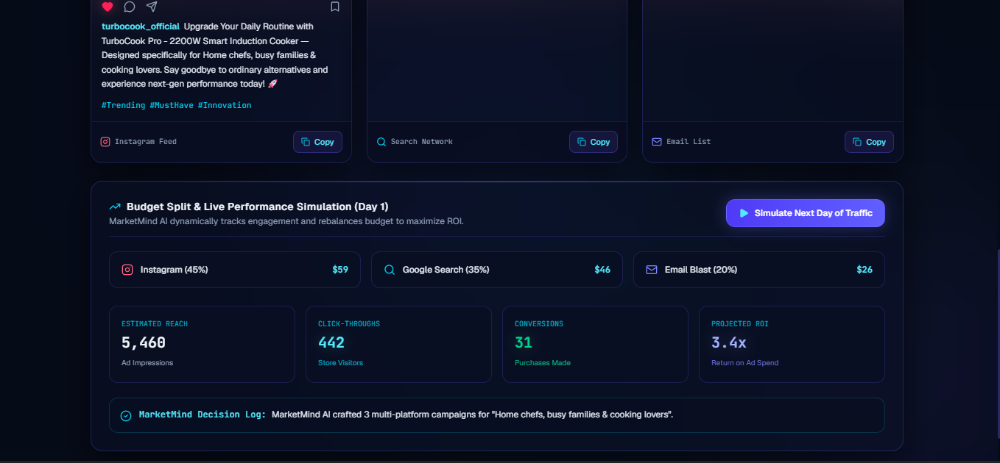

# ⚡ MarketMind AI — Autonomous Campaign & Marketing Intelligence

**MarketMind AI** is a full-stack autonomous digital marketing agent and campaign intelligence platform powered by **Google Gemini (`@google/genai`)**. Designed for small e-commerce brands, founders, and marketers, it transforms a product name, target audience, and budget into ready-to-deploy multi-platform ad creatives, dynamic budget allocations, and live traffic/ROI simulations.

---

## 📸 Interface Preview

| Campaign Setup & Multi-Platform Ad Generation | Dynamic Budget Split & Live ROI Simulation |
| :---: | :---: |
|  |  |

---

## ✨ Key Features

- **Autonomous Multi-Channel Copywriting:** Generates tailored ad creatives simultaneously across **Instagram Feed** (hooks, captions, hashtags), **Google Search Ads** (SEO-optimized headlines & descriptions), and **Email Campaigns** (high-converting subject lines & direct pitches).
- **Intelligent Budget Allocation Engine:** Automatically distributes total campaign spend across high-performing channels (Instagram, Google Search, Email Blast) based on target audience behavior.
- **Live Performance & Traffic Simulation:** Interactive day-by-day campaign simulator projecting **Estimated Reach (Impressions)**, **Click-Throughs**, **Conversions**, and **Projected ROI (ROAS)** while dynamically rebalancing budgets.
- **Real-Time Agent Telemetry & Decision Logs:** Tracks agent pipeline states (`RUNNING`, `REASONING`, `CONVERGED`), token processing metrics, and transparent decision logs explaining campaign choices.
- **One-Click Copy & Preview Cards:** Native-style UI mockups for social, search, and email placements with instant clipboard export.

---

## 🛠️ Tech Stack

- **Frontend:** React, TypeScript, Vite, Tailwind CSS, Lucide Icons
- **Backend:** Node.js, Express, `tsx`
- **AI Engine:** Google Gemini API (`@google/genai`)

---

## 📂 Project Structure

```text
MarketMind-AI/
├── src/
│   ├── components/
│   │   └── AdPreviews.tsx       # Multi-platform ad mockup cards (Instagram, Search, Email)
│   ├── data/                    # Default campaign presets & simulation baselines
│   ├── types/
│   │   └── agent.ts             # PipelineNode, AgentStatus & ChannelType definitions
│   ├── App.tsx                  # Main dashboard, budget slider & simulation state
│   └── main.tsx                 # React entry point
├── server.ts                    # Express server & GoogleGenAI API integration
├── .env.example                 # Environment variable template
├── package.json
└── vite.config.ts
```

---

## 🚀 Getting Started

### Prerequisites

- **Node.js** (v18 or higher) and **npm**
- A **Google Gemini API Key** (get one from [Google AI Studio](https://aistudio.google.com/))

### Installation & Local Setup

1. **Clone the repository**
   ```bash
   git clone https://github.com/E-TAT/MarketMind-AI.git
   cd MarketMind-AI
   ```

2. **Install dependencies**
   ```bash
   npm install
   ```

3. **Set up environment variables**
   Copy `.env.example` to `.env` and add your Gemini API key:
   ```bash
   cp .env.example .env
   ```
   Open `.env` and update the values:
   ```env
   GEMINI_API_KEY="your_google_gemini_api_key_here"
   PORT=3000
   ```

4. **Start the development server**
   ```bash
   npm run dev
   ```
   The Express + Vite server will start on **`http://localhost:3000`**.

### Available Scripts

| Command | Description |
| :--- | :--- |
| `npm run dev` | Starts the Express backend and Vite frontend in development mode |
| `npm run build` | Builds the production frontend bundle into `dist/` |
| `npm run lint` | Runs TypeScript type-checking (`tsc --noEmit`) |
| `npm run preview` | Previews the production build locally |

---

## 🔮 Future Roadmap

- Multimodal product image upload for automated visual attribute extraction
- Live web competitor & keyword scraping integration
- Multi-language regional campaign localization
- Direct Meta Ads & Google Ads API publishing


