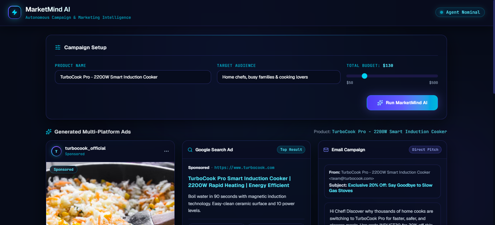

# ⚡ MarketMind AI — Autonomous Campaign & Marketing Intelligence

**MarketMind AI** is a full-stack autonomous digital marketing agent and campaign intelligence platform powered by **Google Gemini (`@google/genai`)**[cite: 43, 45]. Designed for small e-commerce brands, founders, and marketers, it transforms a product name, target audience, and budget into ready-to-deploy multi-platform ad creatives, dynamic budget allocations, and live traffic/ROI simulations[cite: 9, 45].

---

## 📸 Interface Preview

| Campaign Setup & Multi-Platform Ad Generation | Dynamic Budget Split & Live ROI Simulation |
| :---: | :---: |
| [cite: 45] | [cite: 45] |

---

## ✨ Key Features

- **Autonomous Multi-Channel Copywriting:** Generates tailored ad creatives simultaneously across **Instagram Feed** (hooks, captions, hashtags), **Google Search Ads** (SEO-optimized headlines & descriptions), and **Email Campaigns** (high-converting subject lines & direct pitches)[cite: 45].
- **Intelligent Budget Allocation Engine:** Automatically distributes total campaign spend across high-performing channels (e.g., Instagram, Google Search, Email Blast) based on target audience behavior[cite: 45].
- **Live Performance & Traffic Simulation:** Interactive day-by-day campaign simulator projecting **Estimated Reach (Impressions)**, **Click-Throughs**, **Conversions**, and **Projected ROI (ROAS)** while dynamically rebalancing budgets[cite: 45].
- **Real-Time Agent Telemetry & Decision Logs:** Tracks agent pipeline states (`RUNNING`, `REASONING`, `CONVERGED`), token processing metrics, and transparent decision logs explaining campaign choices[cite: 44, 45].
- **One-Click Copy & Preview Cards:** Native-style UI mockups for social, search, and email placements with instant clipboard export[cite: 45].

---

## 🛠️ Tech Stack

- **Frontend:** React, TypeScript, Vite, Tailwind CSS, Lucide Icons
- **Backend:** Node.js, Express, `tsx`[cite: 1, 43]
- **AI Engine:** Google Gemini API (`@google/genai`)

---

## 📂 Project Structure

```text
digital-market-agent/
├── src/
│   ├── components/
│   │   └── AdPreviews.tsx       # Multi-platform ad mockup cards (Instagram, Search, Email)[cite: 43, 45]
│   ├── data/                    # Default campaign presets & simulation baselines[cite: 43]
│   ├── types/
│   │   └── agent.ts             # PipelineNode, AgentStatus & ChannelType definitions[cite: 44]
│   ├── App.tsx                  # Main dashboard, budget slider & simulation state[cite: 43, 45]
│   └── main.tsx                 # React entry point[cite: 43]
├── server.ts                    # Express server & GoogleGenAI API integration[cite: 43]
├── .env.example                 # Environment variable template[cite: 1]
├── package.json
└── vite.config.ts